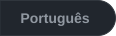
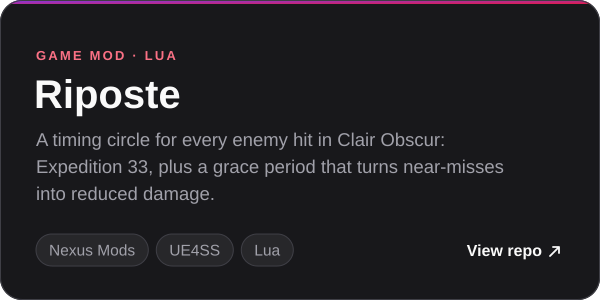
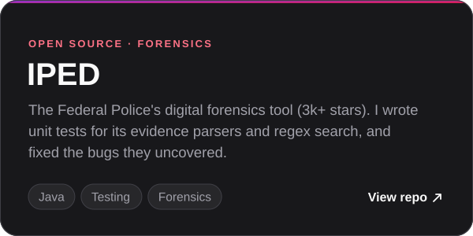

<picture>
  <source media="(prefers-color-scheme: dark)" srcset="assets/header-dark.svg">
  
</picture>

<a href="#impact"><b>Impact</b></a> &nbsp;·&nbsp; <a href="#experience"><b>Experience</b></a> &nbsp;·&nbsp; <a href="#stack"><b>Stack</b></a> &nbsp;·&nbsp; <a href="#projects"><b>Projects</b></a> &nbsp;·&nbsp; <a href="#lets-talk"><b>Contact</b></a>

## Impact

<picture>
  <source media="(prefers-color-scheme: dark)" srcset="assets/impact-dark.svg">
  
</picture>

## Experience

<picture>
  <source media="(prefers-color-scheme: dark)" srcset="assets/job-haistack-dark.svg">
  
</picture>

<b>What I built at Haistack</b>

- Migrated platform search from Sphinx to **Elasticsearch** and made it **dramatically faster**, then added keyword search with highlighted matches across candidates, notes, emails and submissions.
- Built the **placements module** that runs the firm's placement revenue: commission splits, signing bonuses and deal notifications.
- Hardened **security** with SMS two-factor authentication, an API key lifecycle, vendor permission rules and CSV formula-injection protection.
- Shipped **LLM features** in the CRM, such as candidate recommendations and AI-drafted recruiter emails.
- Set up the team's **AI-assisted development workflow**: a shared knowledge base and runbooks that let coding agents investigate, plan and ship changes within the team's conventions.

<picture>
  <source media="(prefers-color-scheme: dark)" srcset="assets/job-ploomes-dark.svg">
  
</picture>

<b>What I built at Ploomes</b>

- Replaced manual, unsafe deploys that often broke and needed rollbacks with **automated CI/CD on Kubernetes** for the email and integrations services, and made them stable.
- Consolidated the **email microservices into the monolith**, drastically cutting debugging time.
- Built and maintained **CRM integrations** with RD Station, Neppo, Flowbiz, WhatsApp and Facebook Lead Ads.
- Wrote the **missing documentation** for the email and integrations domains and created operational routines for them.
- Refactored legacy code for maintainability and security, and **led the team informally for four months**.

<picture>
  <source media="(prefers-color-scheme: dark)" srcset="assets/job-dimensa-dark.svg">
  
</picture>

<b>What I built at Dimensa</b>

- **Led two teams** of 6–7 developers for two and a half years.
- Delivered **7+ white-label banking apps**, each tailored to the client's product and brand.
- Implemented **Pix** payments and refunds in the white-label core, live in production across the apps built on it.

## Stack

**Language-agnostic.** I pick the tool for the problem, not the other way around, and ramp up fast on new stacks.

<picture>
  <source media="(prefers-color-scheme: dark)" srcset="assets/stack-dark.svg">
  
</picture>

## Projects

 

## Let's talk

Always up for a conversation about product engineering, search, integrations or AI-assisted development. Based in Brasília; studied at Universidade de Brasília (UnB).

