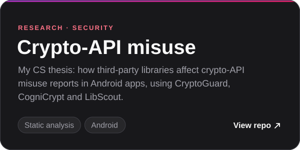

<picture>
  <source media="(prefers-color-scheme: dark)" srcset="assets/header-dark.svg">
  
</picture>

<a href="#impact"><b>Impact</b></a> &nbsp;·&nbsp; <a href="#experience"><b>Experience</b></a> &nbsp;·&nbsp; <a href="#stack"><b>Stack</b></a> &nbsp;·&nbsp; <a href="#security--research"><b>Security</b></a> &nbsp;·&nbsp; <a href="#projects"><b>Projects</b></a> &nbsp;·&nbsp; <a href="#lets-talk"><b>Contact</b></a>

## Impact

<picture>
  <source media="(prefers-color-scheme: dark)" srcset="assets/impact-dark.svg">
  
</picture>

## Experience

<picture>
  <source media="(prefers-color-scheme: dark)" srcset="assets/job-haistack-dark.svg">
  
</picture>

<b>What I built at Haistack</b>

- Migrated platform search from Sphinx to **Elasticsearch**, then added keyword search with highlighted matches across candidates, notes, emails and submissions.
- Built the **placements module** that runs the firm's placement revenue: commission splits, signing bonuses and deal notifications.
- Hardened **security** with SMS two-factor authentication, an API key lifecycle, vendor permission rules and CSV formula-injection protection.
- Shipped **LLM features** in the CRM, such as candidate recommendations and AI-drafted recruiter emails.
- Set up the team's **AI-assisted development workflow**: a shared knowledge base and runbooks that let coding agents investigate, plan and ship changes within the team's conventions.

<picture>
  <source media="(prefers-color-scheme: dark)" srcset="assets/job-ploomes-dark.svg">
  
</picture>

<b>What I built at Ploomes</b>

- Replaced manual, unsafe deploys that often broke and needed rollbacks with **automated CI/CD on Kubernetes** for the email and integrations services, and made them stable.
- Consolidated the **email microservices into the monolith**, making the flow simpler to run and debug.
- Replaced Datadog with **OpenTelemetry** for logging and telemetry across the email services.
- Built and maintained [**13 CRM integrations**](https://www.ploomes.com/produto/integracoes): RD Station, ActiveCampaign, Neppo, Flowbiz, WhatsApp, Facebook Lead Ads, Mailchimp, Meetime, Omie, Outlook, Gmail, Google Calendar and Zenvia.
- Wrote the **missing documentation** for the email and integrations domains and created operational routines for them.
- Hardened the integrations: **OAuth** flows, **URL sanitization**, permission checks and a **secrets-rotation runbook**.
- Brought **AI-assisted development** into my workflow in early 2026, with context files for each service and an integrations knowledge base for coding agents.
- Refactored legacy code for maintainability and security, and **informally led a team of 7 for four months**.

<picture>
  <source media="(prefers-color-scheme: dark)" srcset="assets/job-dimensa-dark.svg">
  
</picture>

<b>What I built at Dimensa</b>

- **Led two teams** of 7 people for two and a half years.
- At Dimensa (mobile2you), delivered **7+ white-label banking apps** for client banks such as [Banco BV](https://www.bv.com.br), [Travelex Bank](https://www.travelexbank.com.br), [Dock](https://dock.tech), [Bankly (Acesso)](https://bankly.com.br) and [Banco BBC Digital](https://bancobbcdigital.com.br), each tailored to the client's product and brand.
- Worked on the **Dimensa app**, the rebuild of the white-label platform itself.
- Implemented **Pix** payments and refunds in the white-label core, live in production across the apps built on it.

## Education

<picture>
  <source media="(prefers-color-scheme: dark)" srcset="assets/edu-unb-dark.svg">
  
</picture>

## Stack

**Language-agnostic.** I pick the tool for the problem, not the other way around, and ramp up fast on new stacks.

<picture>
  <source media="(prefers-color-scheme: dark)" srcset="assets/stack-dark.svg">
  
</picture>

## Security & research

Security runs through my work: from research on cryptographic API misuse to tests for a forensic tool used by the Federal Police.

 

## Projects

**From the CS degree:** [Pipelined MIPS CPU](https://github.com/streeg/oac20191unb2) (VHDL) · [Compiler](https://github.com/streeg/guillex2) (C, Flex, Bison) · [Java Virtual Machine](https://github.com/Skalwalker/JVM) (C++) · [Pseudo operating system](https://github.com/streeg/pseudo-os) (Python)

## Let's talk

Always up for a conversation about product engineering, search, integrations or AI-assisted development. Based in Brasília, Brazil.

