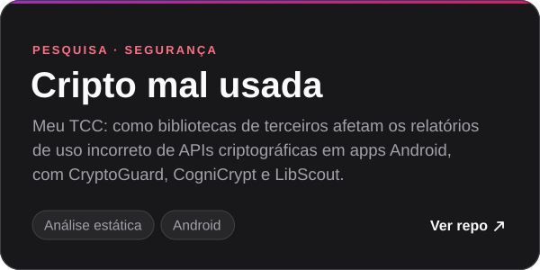
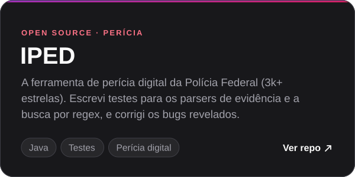
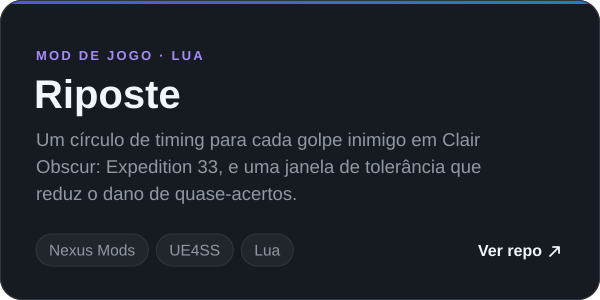

<picture>
  <source media="(prefers-color-scheme: dark)" srcset="assets/header-pt-dark.svg">
  
</picture>

<a href="#impacto"><b>Impacto</b></a> &nbsp;·&nbsp; <a href="#experiência"><b>Experiência</b></a> &nbsp;·&nbsp; <a href="#stack"><b>Stack</b></a> &nbsp;·&nbsp; <a href="#segurança-e-pesquisa"><b>Segurança</b></a> &nbsp;·&nbsp; <a href="#projetos"><b>Projetos</b></a> &nbsp;·&nbsp; <a href="#bora-conversar"><b>Contato</b></a>

## Impacto

<picture>
  <source media="(prefers-color-scheme: dark)" srcset="assets/impact-pt-dark.svg">
  
</picture>

## Experiência

<picture>
  <source media="(prefers-color-scheme: dark)" srcset="assets/job-haistack-pt-dark.svg">
  
</picture>

<b>O que construí na Haistack</b>

- Migrei a busca da plataforma de Sphinx para **Elasticsearch** e depois adicionei busca por palavra-chave, com os termos destacados, em candidatos, notas, e-mails e submissões.
- Construí o **módulo de contratações** que gere a receita das contratações do escritório: divisão de comissões, bônus de assinatura e notificações de cada negociação.
- Reforcei a **segurança** com autenticação em dois fatores por SMS, ciclo de vida de chaves de API, regras de permissão para fornecedores e proteção contra injeção de fórmulas em CSV.
- Entreguei **funcionalidades com LLM** no CRM, como recomendação de candidatos e e-mails de recrutadores redigidos por IA.
- Montei o **fluxo de desenvolvimento assistido por IA** do time: uma base de conhecimento e runbooks compartilhados que permitem a agentes de código investigar, planejar e entregar mudanças dentro das convenções do time.

<picture>
  <source media="(prefers-color-scheme: dark)" srcset="assets/job-ploomes-pt-dark.svg">
  
</picture>

<b>O que construí na Ploomes</b>

- Troquei deploys manuais e inseguros, que quebravam e viviam de rollback, por **CI/CD automatizado no Kubernetes** para os serviços de e-mail e integrações, e deixei tudo estável.
- Consolidei os **microsserviços de e-mail no monolito**, deixando o fluxo mais simples de operar e depurar.
- Troquei o Datadog por **OpenTelemetry** nos logs e na telemetria dos serviços de e-mail.
- Construí e mantive [**13 integrações do CRM**](https://www.ploomes.com/produto/integracoes): RD Station, ActiveCampaign, Neppo, Flowbiz, WhatsApp, Facebook Lead Ads, Mailchimp, Meetime, Omie, Outlook, Gmail, Google Agenda e Zenvia.
- Escrevi a **documentação que não existia** dos domínios de e-mail e integrações e criei rotinas operacionais para eles.
- Reforcei a segurança das integrações: fluxos **OAuth**, **sanitização de URLs**, checagens de permissão e um **runbook de rotação de segredos**.
- Trouxe o **desenvolvimento assistido por IA** para o meu fluxo no início de 2026, com arquivos de contexto por serviço e uma base de conhecimento de integrações para agentes de código.
- Refatorei código legado com foco em manutenibilidade e segurança, e **liderei informalmente um time de 7 pessoas por quatro meses**.

<picture>
  <source media="(prefers-color-scheme: dark)" srcset="assets/job-dimensa-pt-dark.svg">
  
</picture>

<b>O que construí na Dimensa</b>

- **Liderei dois times** de 7 pessoas por dois anos e meio.
- Pela Dimensa (mobile2you), entreguei **7+ apps bancários white-label** para bancos clientes como [Banco BV](https://www.bv.com.br), [Travelex Bank](https://www.travelexbank.com.br), [Dock](https://dock.tech), [Bankly (Acesso)](https://bankly.com.br) e [Banco BBC Digital](https://bancobbcdigital.com.br), cada um adaptado ao produto e à marca do cliente.
- Trabalhei no **app Dimensa**, a reformulação da própria plataforma white-label.
- Implementei **Pix** e devolução de Pix no núcleo white-label, em produção em todos os apps construídos sobre ele.

## Formação

<picture>
  <source media="(prefers-color-scheme: dark)" srcset="assets/edu-unb-pt-dark.svg">
  
</picture>

## Stack

Escolho a ferramenta pelo problema, e não o contrário, e fico produtivo rápido em stacks novas.

<picture>
  <source media="(prefers-color-scheme: dark)" srcset="assets/stack-pt-dark.svg">
  
</picture>

## Segurança e pesquisa

Segurança atravessa meu trabalho: da pesquisa sobre uso incorreto de APIs criptográficas aos testes de uma ferramenta de perícia da Polícia Federal.

 

## Projetos

**Da graduação:** [CPU MIPS com pipeline](https://github.com/streeg/oac20191unb2) (VHDL) · [Compilador](https://github.com/streeg/guillex2) (C, Flex, Bison) · [Máquina Virtual Java](https://github.com/Skalwalker/JVM) (C++) · [Pseudo sistema operacional](https://github.com/streeg/pseudo-os) (Python)

## Bora conversar

Sempre aberto a uma conversa sobre engenharia de produto, busca, integrações ou desenvolvimento assistido por IA. Moro em Brasília.

